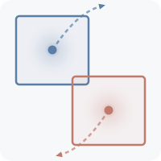

<div align="center">
  <br>
  <h1>Latent Space Jam</h1>
  <b>Layout-Guided Video Generation</b><br>
  <i>Authors TBD</i><br><br>
  <a href="">📄 Paper</a> &nbsp;|&nbsp;
  <a href="https://latent-space-jam.github.io/">🌐 Project Page</a> &nbsp;|&nbsp;
  <a href="">📝 arXiv</a>
</div>

---

> **TL;DR** -- Control *where* objects go and *how* they move in generated videos, without any training.

Latent Space Jam is a **training-free** approach that gives you spatial and temporal control over pretrained video diffusion models using simple binary masks.

**How it works:**

🎯 **Stage 1** -- Generate a layout-consistent video by optimizing cross-attention maps to match your masks.<br>
✨ **Stage 2** -- Refine the result into a high-quality, temporally coherent video using the same model.

**What it supports:**
🔀 Complex trajectories &nbsp;&middot;&nbsp; 👥 Multi-object compositions

> Also enables layout-guided **video editing** via SDEdit — see [notebooks](#video-editing).

---

## Method

Latent Space Jam intercepts cross-attention layers during the diffusion process and uses a **KL-divergence loss** to align token-level attention maps with user-provided layout masks. At selected diffusion steps, the latent tensor is refined via gradient-based optimization, steering generation toward the desired spatial arrangement.

**Supported backbones:**

- [LTX-2/2.3](https://github.com/Lightricks/LTX-2) — weights must be downloaded locally (currently only the 2x spatial upscaler is supported)
- [Wan 2.2](https://github.com/Wan-Video/Wan2.2) — weights auto-downloaded from HuggingFace

---

## ⚙️ Installation

```bash
git clone https://github.com/latent-space-jam/latent-space-jam.git
cd latent-space-jam
uv sync
source .venv/bin/activate
```

> **Requirements:** Python 3.13+, PyTorch 2.9+, CUDA-capable GPU.

### Model Weights

**Wan 2.2** weights are downloaded automatically from HuggingFace on first run.

**LTX-2 / LTX-2.3** weights can be downloaded using the provided script (`src/ltx/download_models.sh`). Requires a [Hugging Face token](https://huggingface.co/settings/tokens).

```bash
# Download all models (LTX-2 + LTX-2.3 + Gemma text encoder)
bash src/ltx/download_models.sh --hf-token <YOUR_HF_TOKEN>

# Download only LTX-2.3 models
bash src/ltx/download_models.sh --hf-token <YOUR_HF_TOKEN> --model ltx2.3

# Download only LTX-2 models
bash src/ltx/download_models.sh --hf-token <YOUR_HF_TOKEN> --model ltx2

# Custom output directory
bash src/ltx/download_models.sh --hf-token <YOUR_HF_TOKEN> --output /data/models
```

By default, weights are placed under the `models/` directory:

```
models/
  ltx-2.3-22b-dev.safetensors
  ltx-2.3-spatial-upscaler-x1.5-1.0.safetensors
  ltx-2.3-spatial-upscaler-x2-1.0.safetensors
  ltx-2.3-22b-distilled-lora-384.safetensors
  ltx-2-19b-dev.safetensors
  ltx-2-spatial-upscaler-x2-1.0.safetensors
  ltx-2-19b-distilled-lora-384.safetensors
  gemma-3-12b-it-qat-q4_0-unquantized/
```

---

## 🚀 Quick Start

### Wan 2.2

```bash
python -m src.wan.main
```

This generates a golden retriever walking in a slalom pattern, using a mask from `data/dynamic/masks/`. The output is saved to `outputs/wan/`.

### LTX-2

```bash
python -m src.ltx.main
```

This generates a cow walking diagonally across the frame using the LTX multi-stage pipeline. The output is saved to `outputs/ltx/`.

---

## 📖 Usage

### Defining a Layout

A layout consists of:

1. **A text prompt** describing the scene.
2. **One or more binary mask videos** (`.mp4`) defining where each subject should appear over time.
3. **Phrase indices** mapping each mask to word(s) in the prompt (0-indexed).

For example, given the prompt `"A cow walking on a grassy field"`:

- `phrase_indices = [[1]]` links the first mask to the word "cow" (index 1).
- The mask video `tl-to-br.mp4` defines a top-left to bottom-right trajectory.

### Parameters

See [data/parameters.md](data/parameters.md) for a full description of all tunable parameters. We recommend starting with the defaults in `main.py` and iterating by inspecting the generated attention maps (saved to `output_path/attention_maps/`) alongside the output video.

### Multi-Object Layouts

For scenes with multiple subjects, provide one mask per subject:

```python
prompt = "Two koi fish swimming in a calm pond, one deep blue and one bright orange"
phrase_indices = [[9, 10], [13, 14]]  # "deep blue", "bright orange"
bbox_paths = [
    "data/multi/masks/circle_cw_r.mp4",  # blue fish trajectory
    "data/multi/masks/circle_cw_l.mp4",  # orange fish trajectory
]
```

### Video Editing

The same attention-optimization mechanism can also be applied to *edit* existing videos via SDEdit. Interactive notebooks are provided for both backbones:

- **Wan 2.2**: `notebooks/editing.ipynb` — SDEdit + layout guidance + source blending.
- **LTX-2**: `notebooks/editing_ltx.ipynb` — SDEdit + layout guidance via the multi-stage pipeline.

---

## 📦 Data

The `data/` directory contains all layout masks used in the paper (dynamic trajectories, multi-object compositions, and static layouts). See [data/README.md](data/README.md) for the full format specification and examples.

---

## 📜 Citation

```bibtex
@article{latentspacejam2025,
  title={Latent Space Jam: Layout-Guided Video Generation},
  author={TBD},
  journal={arXiv preprint arXiv:XXXX.XXXXX},
  year={2025}
}
```

## License

This project is licensed under the [Apache License 2.0](LICENSE).
